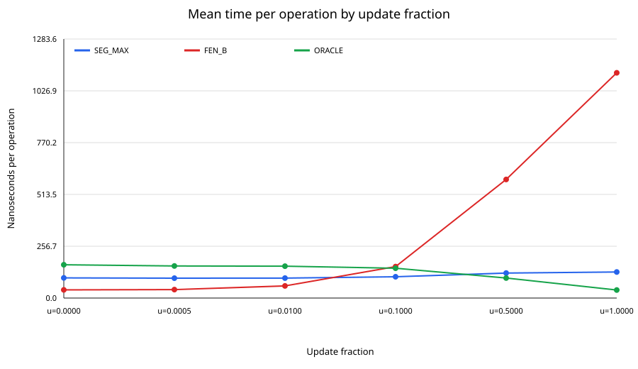
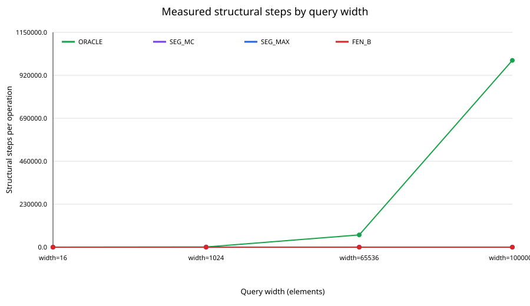
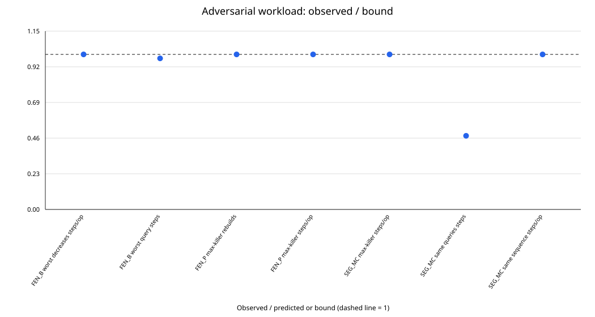
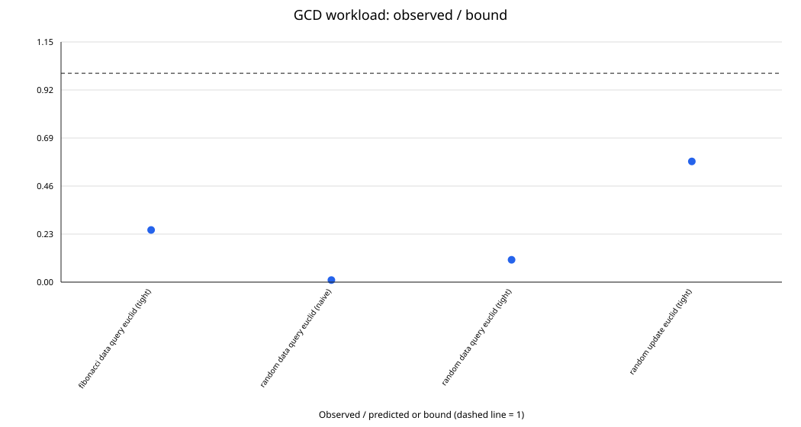

# Project 5 Report

**Team members:** Pranjali,Vinod,Sandeep,Kushaal,Chahak Dhote,Shrawani. 
**Run recorded:** 2026-11-17 05:37:26 UTC  
**Machine / OS:** LINUX , i7 13350h
**Compiler version:** g++ -std=c++17 -O2`

## Design decisions

The application combines a `MaxCount` segment tree for range maximum and multiplicity with a gcd segment tree for calibration factors. Point assignment is required because readings can decrease; a prefix maximum alone cannot repair all affected prefixes cheaply. Structure B implements Dima–Ceterchi’s two-tree Fenwick range maximum and supports decreases by recomputing affected blocks. The prefix-max Fenwick structure remains as an increase-only baseline. A plain-array oracle supplies independent answers for differential tests.

## Predicted-cost model

`bench/cost_model.h` counts structural operations; it does not predict nanoseconds. Let `n` be array length, `w` a query width, `V` the maximum calibration magnitude, `k=ceil(log2 n)`, and `f=floor(log2 n)`.

| Operation / structure | Model used |
|---|---|
| Oracle range query | `w` scanned elements |
| Oracle point assignment | `1` write |
| Segment-tree point assignment | `ceil(log2 n)` ancestor recomputations |
| Segment-tree worst-case range query | `2 ceil(log2 n)` selected nodes |
| Fenwick B range query | At most `1 + 2 floor(log2 n)` pivot/block reads |
| Fenwick B decrease | Exact recomputation count per index; report mean and maximum over all `n` indices |
| Prefix-max Fenwick max-killer decreases | `n + 0.5 floor(log2 n) + 1` predicted steps per update |
| Gcd query, naive estimate | `(2 ceil(log2 n)+1)(log_phi(V)+2)` Euclidean iterations |
| Gcd query, tightened estimate | `2 log_phi(V)+2(2 ceil(log2 n)+1)` Euclidean iterations |
| Gcd point assignment | `log_phi(V)+2 ceil(log2 n)` Euclidean iterations |

Here `phi=(1+sqrt(5))/2`; the gcd estimates use the Fibonacci bound on Euclidean divisions for operands bounded by `V`. Typical segment-tree and Fenwick query costs are calculated over all starts if there are at most 4,096; otherwise they use 4,096 sampled starts with seed `12345`.

The benchmark marks a prediction `ok` when `|observed-predicted| <= max(0.5, 0.20*|predicted|)`. An upper-bound check passes when observed work is no greater than the bound. These checks apply to operation counts, not timings.

## Run protocol and seeds

`./run_all.sh` clears generated outputs, builds with C++17 and `-O2`, runs the full one-million-operation test suite, replays the static one-million-element application input, and runs each benchmark mode once at `n=1000000`. Logs and seeds are saved in `results/raw/`. `collect_measurements.py` parses those logs; `make_figures.py` creates the SVGs. They do not rerun binaries.

| Mode | Reading / calibration data seeds | Workload seeds |
|---|---|---|
| Width | `1 / 2` | Query starts use each tested width; model sampling uses `12345` |
| Mix | `2 / 3` | `5`; width 1024, 4,000 operations, update fractions `0`, `0.0005`, `0.01`, `0.1`, `0.5`, `1` |
| Adversary | `3 / 4` | Deterministic; 400 high-cost decreases, 100 max-killer updates, and up to 1,000 global worst-query ranges |
| Gcd | `4 / 5` | `11`; Fibonacci calibration values are deterministic |

This run contains one timing observation per mix point, so it does not estimate run-to-run timing variation. The benchmark executable and logs did not record the CPU model, OS, or compiler version; fill in those fields from the final presentation-machine run.

## Correctness and measurement results

The full suite passed at `n=1000000`, with one million operations, data seed 1, and event seed 2. The application completed on the one-million-element input and produced four query results:

```text
max=10 count=1 gcd=6
max=9 count=1000000 gcd=6
max=9 count=2 gcd=2
max=9 count=1 gcd=2
```

All benchmark prediction checks were within tolerance, and all stated bounds held.

### Query width: predicted / measured structural steps per query

| Width | Oracle | Segment tree (`SEG_MAX`) | Fenwick B |
|---:|---:|---:|---:|
| 16 | 16 / 16 | 4.06 / 4.05 | 5 / 5 |
| 1,024 | 1,024 / 1,024 | 10.01 / 10.00 | 11 / 11 |
| 65,536 | 65,536 / 65,536 | 16.02 / 16.00 | 17 / 17 |
| 1,000,000 | 1,000,000 / 1,000,000 | 7 / 7 | 26 / 26 |

Each cell is `predicted / measured`. The oracle count is the number of scanned values. Tree counts are structural nodes/blocks visited.

### Mixed workload: predicted / measured structural steps per operation

| Update fraction | Segment tree | Fenwick B | Oracle |
|---:|---:|---:|---:|
| 0 | 10.01 / 10.04 | 11.00 / 11.00 | 1,024.00 / 1,024.00 |
| 0.0005 | 10.02 / 10.04 | 11.10 / 11.05 | 1,023.49 / 1,023.74 |
| 0.01 | 10.11 / 10.15 | 12.99 / 13.14 | 1,013.77 / 1,013.00 |
| 0.1 | 11.01 / 10.95 | 30.87 / 29.13 | 921.70 / 930.65 |
| 0.5 | 15.01 / 15.01 | 110.34 / 110.15 | 512.50 / 513.78 |
| 1 | 20.00 / 20.00 | 209.68 / 209.74 | 1.00 / 1.00 |

### Mixed workload: measured time per operation

One run, nanoseconds per operation:

| Update fraction | Segment tree | Fenwick B | Oracle |
|---:|---:|---:|---:|
| 0 | 59.1 | 23.3 | 95.8 |
| 0.0005 | 56.7 | 23.6 | 91.2 |
| 0.01 | 59.6 | 44.1 | 92.4 |
| 0.1 | 70.4 | 119.0 | 87.6 |
| 0.5 | 80.1 | 290.6 | 56.8 |
| 1 | 83.5 | 467.4 | 8.0 |

Fenwick B uses more structural steps than the segment tree in this workload, but measured faster at update fractions through `0.01`; from `0.1` onward it was slower in this single run. The operation-count model predicts no step-count crossover. This timing pattern is machine- and run-specific.

### Adversarial workloads

| Case | Predicted / bound | Observed | Result |
|---|---:|---:|---|
| Fenwick B high-cost decrease, steps/update | 211 | 211 | Bound met |
| Fenwick B maximum query, steps | 39 | 38 | Bound met |
| Segment-tree same-query upper bound, steps | 40 | 19 | Bound met |
| Prefix max-killer, steps/update | 1,000,010.50 | 1,000,010.29 | Within tolerance |
| Prefix max-killer, rebuilds | 100 | 100 | Exact |

The `worstQueries` generator searches maximum-step ranges across all valid ranges using the binary pivot blocks; it avoids enumerating all `O(n^2)` endpoint pairs.

### Gcd work: Euclidean iterations

| Workload | Bound | Worst observed | Result |
|---|---:|---:|---|
| Random query, tightened estimate | 168.13 | 18 | Bound met |
| Random query, naive estimate | 1,847.65 | 18 | Bound met |
| Fibonacci-data query, tightened estimate | 168.13 | 42 | Bound met |
| Random point update, tightened estimate | 83.06 | 48 | Bound met |

## Figures

Generated from `results/raw/*.csv` by `results/make_figures.py`:









